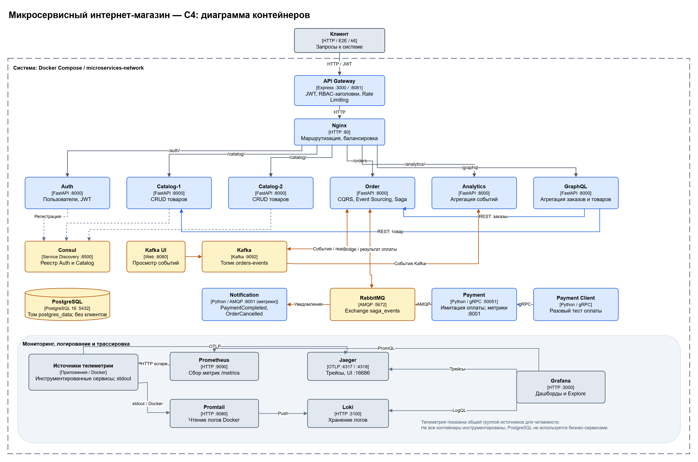
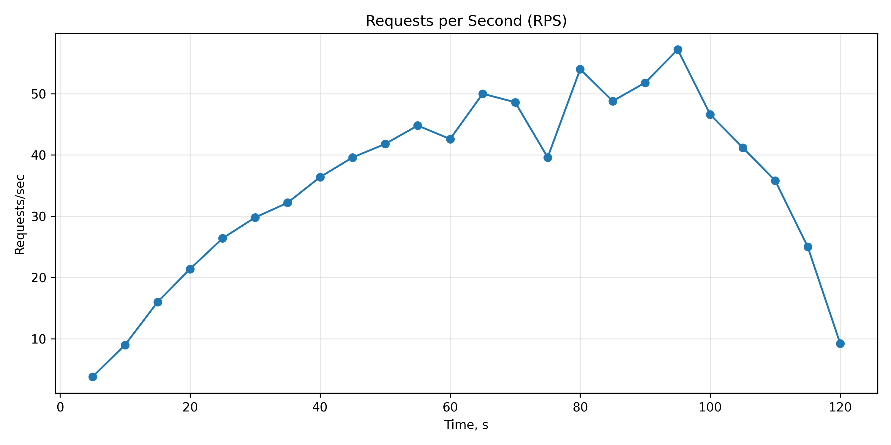
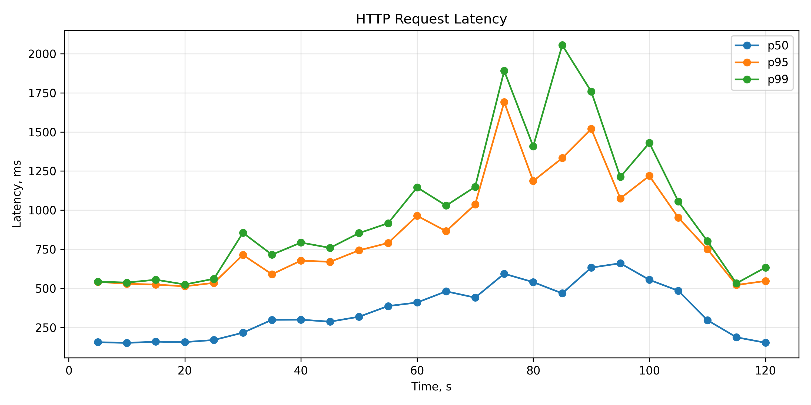
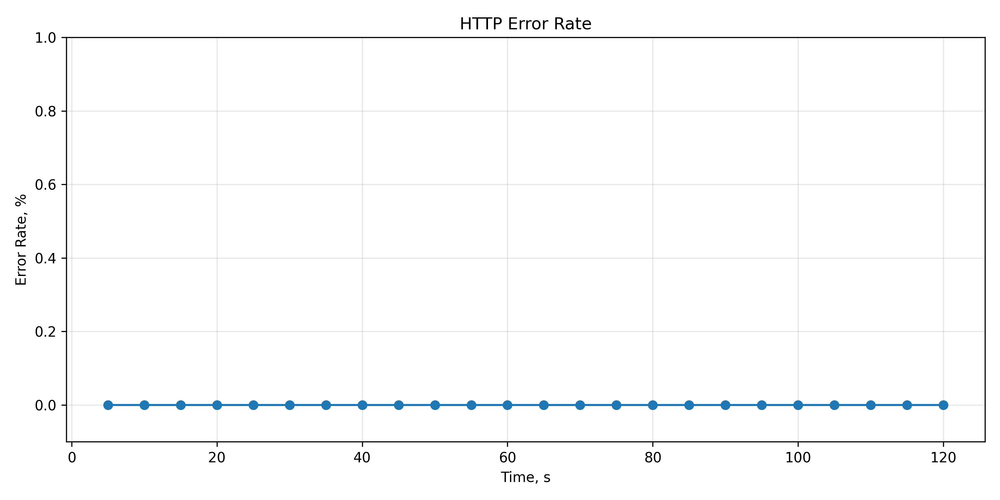

# Архитектура микросервисной системы

## 1. Общее описание

Система представляет собой микросервисное приложение
интернет-магазина.

Все компоненты запускаются с помощью Docker Compose
и взаимодействуют через общую сеть microservices-network.

Взаимодействие сервисов осуществляется посредством
REST API, gRPC, GraphQL и асинхронного обмена сообщениями
через Kafka и RabbitMQ.

## 2. Архитектурная схема

## 3. Описание компонентов системы

| Сервис | Технология | Внутренний порт | Назначение |
|---|---|---|---|
| Gateway | Node.js, Express | 3000 | Единая точка входа, JWT, Rate Limiting |
| Nginx | Nginx | 80 | Маршрутизация и балансировка нагрузки |
| Auth | Python, FastAPI | 8000 | Регистрация и авторизация |
| Catalog-1 | Python, FastAPI | 8000 | Управление каталогом товаров |
| Catalog-2 | Python, FastAPI | 8000 | Второй экземпляр каталога |
| Order | Python, FastAPI | 8000 | Создание и обработка заказов, CQRS, Event Sourcing |
| Payment | Python, gRPC, RabbitMQ | 50051, 8001 | Имитация оплаты заказов |
| Notification | Python, RabbitMQ | 8001 | Обработка событий для уведомления пользователей |
| Analytics | Python, FastAPI, Kafka | 8000 | Агрегация статистики заказов |
| GraphQL | FastAPI, Strawberry | 8000 | Агрегация данных заказов и товаров |
| Payment Client | Python, gRPC | — | Тестирование gRPC-взаимодействия |
| PostgreSQL | PostgreSQL 16 | 5432 | Инфраструктурный компонент хранения данных |
| Consul | HashiCorp Consul | 8500 | Регистрация и обнаружение сервисов |
| Kafka | Apache Kafka | 9092 | Хранение и передача событий |
| Kafka UI | Kafka UI | 8080 | Просмотр топиков и сообщений Kafka |
| RabbitMQ | RabbitMQ | 5672, 15672 | Асинхронная передача сообщений |
| Prometheus | Prometheus | 9090 | Сбор метрик |
| Grafana | Grafana | 3000 | Визуализация метрик и логов |
| Loki | Grafana Loki | 3100 | Централизованное хранение логов |
| Promtail | Promtail | 9080 | Сбор и отправка логов в Loki |
| Jaeger | Jaeger, OpenTelemetry | 16686, 4317, 4318 | Распределённая трассировка |

## 4. Основные REST API

Все клиентские запросы выполняются через API Gateway:
http://localhost:8081.

| Метод | Эндпоинт | Назначение |
|---|---|---|
| POST | /auth/register | Регистрация пользователя |
| POST | /auth/login | Авторизация и получение JWT |
| GET | /auth/me | Получение данных пользователя |
| GET | /catalog/products | Получение списка товаров |
| GET | /catalog/api/catalog/products/{id} | Получение товара по ID |
| POST | /catalog/products | Создание товара |
| PUT | /catalog/products/{id} | Изменение товара |
| DELETE | /catalog/products/{id} | Удаление товара |
| POST | /orders | Создание заказа |
| GET | /orders | Получение списка заказов |
| GET | /orders/{id} | Получение заказа |
| GET | /orders/user/{user_id} | Получение заказов пользователя |
| POST | /orders/{id}/pay | Команда оплаты заказа |
| POST | /orders/{id}/cancel | Команда отмены заказа |
| GET | /analytics/summary | Получение аналитической статистики |
| POST | /graphql | Выполнение GraphQL-запросов |

Payment предоставляет gRPC-метод CheckPaymentStatus.

## 5. Взаимодействие сервисов

### Синхронное взаимодействие

Клиент отправляет HTTP-запрос в API Gateway.
Gateway проверяет JWT и передаёт запрос в Nginx.

Nginx направляет запрос соответствующему сервису.
Запросы к каталогу распределяются между catalog-1
и catalog-2.

GraphQL-сервис агрегирует данные Order и Catalog
через REST API.

### Асинхронное взаимодействие

1\. Order создаёт заказ со статусом CREATED.
2\. Событие OrderCreated сохраняется в Event Store
&#x20;  и публикуется в Kafka-топик orders-events.
3\. Kafka–RabbitMQ Bridge передаёт событие в RabbitMQ.
4\. Payment получает событие и имитирует оплату.
5\. Payment публикует PaymentCompleted или PaymentFailed.
6\. Order получает результат оплаты.
7\. При успешной оплате заказ получает статус CONFIRMED.
8\. При отказе оплаты заказ получает статус CANCELLED.
9\. Order публикует соответствующее событие в Kafka.
10\. Analytics обновляет статистику.
11\. Notification обрабатывает события для уведомления
&#x20;   пользователя.

Основные события:

- OrderCreated
- OrderPaid
- OrderCancelled
- PaymentCompleted
- PaymentFailed

Kafka используется для передачи истории событий,
обновления read-модели и аналитики.

RabbitMQ используется для асинхронного взаимодействия
Order, Payment и Notification.

## 6. Хранение данных

В Order реализованы паттерны CQRS и Event Sourcing.

Write Side обрабатывает команды и сохраняет события
в Event Store.

Read Side обновляет отдельную модель чтения
при получении событий Kafka.

PostgreSQL включён в Docker Compose и использует
постоянный том postgres_data.

В текущей учебной реализации Auth, Catalog,
Event Store и модели чтения используют
хранение данных в оперативной памяти.

Analytics восстанавливает статистику на основе
событий Kafka.

Бизнес-сервисы непосредственно к PostgreSQL
не подключены.

## 7. Безопасность

Аутентификация реализована с использованием JWT.

API Gateway проверяет подпись токена и срок
его действия.

Во внутренние сервисы передаются заголовки:

- X-User-Id
- X-User-Role

Используются роли user и admin.

Создание и удаление товаров доступны администратору.

Создание заказов доступно авторизованным пользователям.

Ограничения количества запросов:

- 100 запросов за 15 минут;
- 5 попыток авторизации за 15 минут.

Секреты и параметры подключения задаются через .env.
Файл .env исключён из Git.

## 8. Мониторинг и трассировка

Prometheus собирает технические и бизнес-метрики.

Grafana визуализирует:

- количество HTTP-запросов;
- ошибки;
- время ответа;
- загрузку CPU наблюдаемых процессов;
- потребление оперативной памяти;
- количество заказов и платежей.

Loki и Promtail обеспечивают централизованный
сбор логов.

OpenTelemetry передаёт контекст трассировки
через HTTP, Kafka и RabbitMQ.

Jaeger отображает распределённые трейсы.

Полный E2E-сценарий объединён одним Trace ID.

## 9. Надёжность системы

В Docker Compose настроены healthcheck
и зависимости service_healthy.

Consul регистрирует Auth и два экземпляра Catalog.

Nginx распределяет запросы между экземплярами Catalog.

При остановке catalog-1 запросы продолжают
обрабатываться экземпляром catalog-2.

## 10. Результаты E2E-тестирования

Автоматизированный тест проверяет:

1\. Регистрацию пользователя.
2\. Авторизацию и получение JWT.
3\. Получение каталога товаров.
4\. Создание заказа.
5\. Автоматическую оплату.
6\. Получение статуса CONFIRMED.
7\. Обновление аналитики.

Результат: E2E TEST PASSED: 7/7.

Характеристики полного трейса Jaeger:

- Продолжительность: 2,8 с.
- Количество сервисов и тестовых клиентов: 8.
- Количество spans: 96.
- Глубина трейса: 14.

## 11. Результаты нагрузочного тестирования

Инструмент: k6 версии 2.4.0.

Сценарий: авторизация, получение каталога,
создание заказа.

Параметры нагрузки:

- 30 секунд: увеличение до 20 VUs;
- 60 секунд: увеличение до 50 VUs;
- 30 секунд: снижение до 0 VUs.

| Показатель | Два Catalog | Один Catalog |
|---|---:|---:|
| Максимальное количество VUs | 50 | 50 |
| Продолжительность, с | 121,3 | 121,4 |
| HTTP-запросы | 4258 | 4378 |
| Средний RPS | 35,10 | 36,07 |
| Среднее время ответа, мс | 413,42 | 394,20 |
| p50, мс | 378,31 | 370,96 |
| p95, с | 1,08 | 1,02 |
| p99, с | 1,49 | 1,48 |
| Максимальное время ответа, с | 2,11 | 2,42 |
| Error Rate | 0% | 0% |
| Успешные проверки | 100% | 100% |
| Завершённые итерации | 1419 | 1459 |

Максимальный измеренный RPS первого теста
за пятисекундный интервал: 57,2 запроса в секунду.

### График RPS

### График Latency

### График Error Rate

## 12. Анализ производительности

Система успешно обработала нагрузку
до 50 виртуальных пользователей без HTTP-ошибок.

При увеличении нагрузки наблюдается рост
времени ответа.

Наибольшая загрузка CPU наблюдалась у Auth.
Вероятной причиной являются вычислительно
затратные операции проверки паролей bcrypt.

Рекомендуемые способы оптимизации:

- горизонтальное масштабирование Auth;
- оптимизация обработки запросов;
- контроль потребления памяти;
- дальнейшее исследование производительности
&#x20; при увеличении количества пользователей.

Проверка отказоустойчивости показала,
что отключение одного экземпляра Catalog
не нарушает выполнение основного бизнес-сценария
при исследованной нагрузке.

## 13. Ограничения текущей реализации

Хранилища в оперативной памяти не обеспечивают
полного сохранения состояния после перезапуска.

Изменения каталога не синхронизируются
между двумя экземплярами.

GraphQL напрямую обращается к catalog-1,
поэтому отказоустойчивость GraphQL отдельно
не подтверждена.

Предельная производительность системы
не определялась.

Оплата и отправка уведомлений имитируются.
